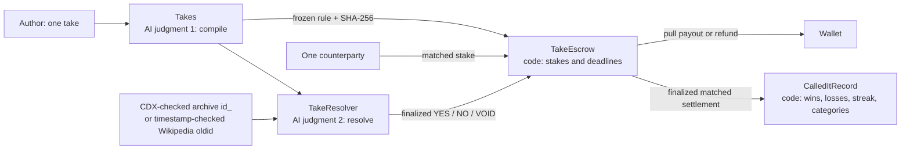

# Called It

**Put GEN on your hot take. GenLayer validators decide who called it.**

Called It is a one-on-one wager on a public announcement. An independently verified compilation freezes the proposition, official-evidence standard, event window, default and source domains before either side deposits. A second judgment resolves immutable evidence. Plain Python handles stakes, odds, deadlines, refunds, payouts and records.

The live release URL, repository, canonical contract links and finalized transaction receipts are generated into [RELEASE.md](docs/RELEASE.md). The authoritative machine-readable record is [deploy/proof.json](deploy/proof.json). A deployment or screenshot alone does not establish demo completion; inspect `releaseStatus`, the verification report and documented blockers.



The app is a social receipts feed, with wallet-free evidence inspection, rule review before staking, opposite-side reservations, evidence preflight, full ruling receipts and public profiles. Recorded proof is explicitly labelled; **Read live** requests finalized state through the Next.js API. The transaction tracker persists hashes across reloads, polls at ten-second intervals, distinguishes accepted from finalized success/error, and follows finality callbacks and native transfer children.

## Run locally

Requires Node.js 22+ and Python 3.12+. Windows direct tests include a narrowly scoped temporary-stdin compatibility shim.

```sh
npm ci
python -m pip install -r requirements.txt
npm run dev
```

The app runs at `http://localhost:3130`. No environment variable or secret is required to inspect recorded or live public state. Connect an EIP-1193 wallet for writes; the adapter requests StudioNet chain 61999 and supplies explicit legacy zero gas-price fields for this gasless network. The pinned `genlayer-js` 1.1.8 does not expose the newer `fees` option. Python release calls use `genlayer-py==0.18.0` and an explicit `feeValue: 0`; a newly nonzero fee stops the release for owner approval.

## Release and resume

All product contracts pin `py-genlayer:1jb45aa8ynh2a9c9xn3b7qqh8sm5q93hwfp7jqmwsfhh8jpz09h6`. Release scripts send a browser user agent. Transaction hashes are saved **before** polling, so rerunning a stage follows the existing submission. Never remove a pending or failed hash to make a report look clean.

```sh
npm run probe
npm run release -- deploy
npm run release -- compile
# Owner approval and demo-wallet funding are required before this stage:
npm run release -- fund
npm run release -- evidence
npm run release -- resolve
npm run settle
npm run release -- record
npm run proof:links
npm run verify:proof
```

`npm run settle` is a resumable keeper: it skips takes that are not ready, settles finalized results or expired refunds, claims payouts for the locally generated demo wallets, verifies their exact native transfer receipts, and updates the public record. It does not advance time or fabricate evidence. A native transfer failure needs a finalized receipt before a safe retry. Keep `.secrets/demo-accounts.json` to resume the same wallets; it is gitignored and excluded from Vercel.

The `fund` stage requires `.secrets/deposit-approval.json` with the owner's explicitly approved cumulative limit. Do not create that approval from silence. The planned demo ceiling is 20 wei, including contingency; the ordinary replay and two live takes use 16 wei. Wallet funding and contract deposits are journalled separately. Nothing is submitted to the Portal.

## Verify

```sh
npm run typecheck
npm run lint
npm test
npm run test:contract
npm run build
genvm-lint check contracts/takes.py
genvm-lint check contracts/take_escrow.py
genvm-lint check contracts/take_resolver.py
genvm-lint check contracts/called_it_record.py
npm run verify:proof
```

The proof verifier is read-only: it never loads the demo keys, signs, deposits or resolves a take. It verifies source hashes against deployed code, finalized execution results, live state, rule hashes, payout conservation, native transfer credits, reviewer evidence URLs and the explorer's actual API records. Contract pages must identify a `CONTRACT`; transaction API objects must contain the exact hash. Every publication URL is generated by the same [explorer helper](lib/explorer.ts), including documentation and Portal fields through `scripts/links.ts`.

## Evidence and limitations

Historical replays explicitly backdate the **event** as-of time; only the deployment owner can create them. Production takes always use transaction creation time. Replay acceptance and evidence submission use separate present-day deadlines. Profiles include a historical flag on every entry; their current streak follows finalized record insertion order, not historical event chronology. Only matched, finalized settlements enter records. An unfunded public judgment cannot create a win.

Archive captures must exist exactly in CDX and fall strictly after the rule's as-of time and at or before deadline + 72 hours. Wikipedia revisions require server metadata for their actual revision timestamp. The code bounds responses to 2 MB and extracts at most 24,000 characters of main text before prompting. This conservative bound can omit a decisive passage on a very long page. Up to two unique links per party are considered; all leader quotes must occur in the validator's own extracted text, and validators independently reach the same verdict. No live page is settlement evidence.

Allowlisting does not guarantee access. The saved StudioNet probes record Reuters 401 and AP/Oscars 403 responses; these are not silently treated as evidence. If all submitted sources fail, resolution uses the frozen default. If consensus never finalizes, the resolution timeout applies that default; escrow independently exposes a later void-refund deadline. **NO by default is distinct from a model-confirmed NO.**

An invalid payable `deposit` becomes pullable credit. Runtime-failed deposits require a finalized failed receipt proving actual native credit, the original sender, this escrow recipient and unaccounted backing. Recoveries are one-time. Ordinary transfers sent directly to the contract outside `deposit` are not a supported staking flow. Source access, validator availability, RPC limits and browser wallet compatibility remain real operational constraints.

Excluded topics are politics/elections, harm to people, private individuals, health outcomes and financial asset prices. Company publication announcements are allowed; their financial values are not bet on. This StudioNet demonstration uses simulated GEN.

See [the tutorial](docs/TUTORIAL.md), [the two-minute demo](docs/DEMO.md), [release evidence](docs/RELEASE.md) and [Portal draft](docs/submission/portal-fields.json).
