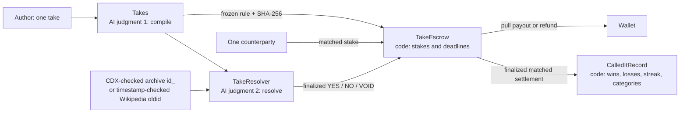

# Called It

**Put GEN on your hot take. GenLayer validators decide who called it.**

[Open Called It](https://called-it-genlayer.vercel.app) · [Public repository](https://github.com/JWattjr/called-it) · [Verification record](docs/VERIFICATION.md)

**Revision 4: awaiting genuine timeout recovery after the matched-bet consensus failure.** Apple resolved YES, Nintendo NO, the no-evidence case applied its frozen NO default, and the subjective claim was rejected. Of 36 new writes and callbacks, 35 finalized successfully; the funded take-5 ruling finalized `MAJORITY_DISAGREE` and applied no outcome. Both stakes remain in escrow. All four deployed code hashes match local files and manifest. Production still serves revision 2. See the [current verification report](docs/VERIFICATION.md) for the failure and limits; revision 3's failures remain in [its historical report](docs/FAIRNESS-REVISION.md).

The resolver's model-output handling has been [repaired and tested](docs/MODEL-OUTPUT-REPAIR.md): 69 contract tests and 21 release tests pass. The core real rulings passed, but the later matched ruling did not reach agreement despite a valid leader proposal. The owner approved two additional simulated wei, and the 1+1 wei bet consumed the full 22-wei cumulative limit. Settlement and native-credit proof remain unproven. Chain writes stopped at the failure, without retry or production publication.

The isolated [v2 diagnostic candidate](docs/CONSENSUS-DIAGNOSIS.md) passed Nintendo NO, Grammy VOID_INSUFFICIENT_EVIDENCE and Apple YES with finalized callbacks and matching reads. Its predecessor's Nintendo regression remains archived. Neither candidate replaces the configured resolver. Original stakes remain intact. The owner-approved 23 October 22:06 Africa/Lagos follow-up will verify the genuine timeout refunds, then continue release checks and publication only after verification passes.

| Contract | Revision-4 address |
| --- | --- |
| Takes | [0x1F797270d45281Aae3842Bd1f4ccE9eb114b51cA](https://explorer-studio.genlayer.com/address/0x1F797270d45281Aae3842Bd1f4ccE9eb114b51cA) |
| TakeEscrow | [0xC5BeB6B171f37f2c7101EDc83eA2905615415e12](https://explorer-studio.genlayer.com/address/0xC5BeB6B171f37f2c7101EDc83eA2905615415e12) |
| TakeResolver | [0xB614CbddBCe32f5ec68BA563957D6E4fB804a52e](https://explorer-studio.genlayer.com/address/0xB614CbddBCe32f5ec68BA563957D6E4fB804a52e) |
| CalledItRecord | [0x6E3419ab4941cd39046973985fD363728D61dBd6](https://explorer-studio.genlayer.com/address/0x6E3419ab4941cd39046973985fD363728D61dBd6) |

Called It is a one-on-one wager on a public announcement. An independently verified compilation freezes the proposition, official-evidence standard, event window, default and source domains before either side deposits. A second judgment resolves immutable evidence. Plain Python handles stakes, odds, deadlines, refunds, payouts and records.

The live release URL, repository, canonical contract links and finalized transaction receipts are generated into [RELEASE.md](docs/RELEASE.md). The authoritative machine-readable record is [deploy/proof.json](deploy/proof.json). A deployment or screenshot alone does not establish demo completion; inspect `releaseStatus`, the verification report and documented blockers.



The app is a social receipts feed, with wallet-free evidence inspection, rule review before staking, opposite-side reservations, evidence preflight, full ruling receipts and public profiles. Recorded proof is explicitly labelled; **Read live** requests finalized state through the Next.js API. The transaction tracker persists hashes across reloads, polls at ten-second intervals, distinguishes accepted from finalized success/error, and follows finality callbacks and native transfer children.

A live feed read loads the latest 25 of the first 100 take IDs and up to eight participant profiles. Individual take and wallet URLs read the requested item directly. Reads bypass stale cached data after finality; partial reads identify the take they refreshed. The server queues actual RPC requests at its minute limit, so a large refresh can take several minutes. Its cache and budget are scoped to a running server instance. Recorded receipts remain visible if the network is unavailable.

## Run locally

Requires Node.js 22+ and Python 3.12+. Windows direct tests include a narrowly scoped temporary-stdin compatibility shim.

```sh
npm ci
python -m pip install -r requirements.txt
npm run dev
```

The app runs at `http://localhost:3130`. No environment variable or secret is required to inspect recorded or live public state. Connect an EIP-1193 wallet for writes; the adapter requests StudioNet chain 61999 and supplies explicit legacy zero gas-price fields for this gasless network. The pinned `genlayer-js` 1.1.8 does not expose the newer `fees` option. Python release calls use `genlayer-py==0.18.0` and an explicit `feeValue: 0`; a newly nonzero fee stops the release for owner approval.

## Release and resume

All product contracts pin `py-genlayer:1jb45aa8ynh2a9c9xn3b7qqh8sm5q93hwfp7jqmwsfhh8jpz09h6`. Release scripts send a browser user agent. Transaction hashes are saved **before** polling, so rerunning a stage follows the existing submission. Never remove a pending or failed hash to make a report look clean.

A private broadcast marker is written immediately before sending a signed transaction. If the send response is lost, the script blocks a second submission under that label. Reconcile the original wallet transaction on Explorer and bind its hash to the existing journal label before resuming; deleting the marker and blindly resending is unsafe. Read-only transport failures can be retried without broadcasting a second payment.

```sh
npm run probe
npm run release -- deploy
npm run release -- compile
# Owner approval and demo-wallet funding are required before this stage:
npm run release -- fund
npm run release -- evidence
npm run release -- resolve
npm run settle
npm run release -- record
npm run proof:links
npm run verify:proof
```

`npm run settle` is a resumable keeper: it skips takes that are not ready, settles finalized results or expired refunds, claims payouts for the locally generated demo wallets, verifies their exact native transfer receipts, and updates the public record. It does not advance time or fabricate evidence. A native transfer failure needs a finalized receipt before a safe retry. Keep `.secrets/demo-accounts.json` to resume the same wallets; it is gitignored and excluded from Vercel.

The `fund` stage requires `.secrets/deposit-approval.json` with the owner's explicitly approved cumulative limit. Do not create that approval from silence. The cumulative ceiling is 22 wei: revision 2 deposited 18, revision 3 deposited two, and the owner-approved revision-4 extension deposited two. The budget is exhausted. Both later matched bets retain two wei each on their own escrows; the two revision-2 live takes retain four wei total. Recovered payouts do not reset the cumulative limit. Wallet funding and contract deposits are journalled separately. Nothing is submitted to the Portal.

## Verify

```sh
npm run typecheck
npm run lint
npm test
npm run test:contract
npm run build
genvm-lint check contracts/takes.py
genvm-lint check contracts/take_escrow.py
genvm-lint check contracts/take_resolver.py
genvm-lint check contracts/called_it_record.py
npm run verify:proof
```

The proof verifier is read-only: it never loads the demo keys, signs, deposits or resolves a take. It verifies source hashes against deployed code, finalized execution results, live state, rule hashes, payout conservation, native transfer credits, reviewer evidence URLs and the explorer's actual API records. Contract pages must identify a `CONTRACT`; transaction API objects must contain the exact hash. Every publication URL is generated by the same [explorer helper](lib/explorer.ts), including documentation and Portal fields through `scripts/links.ts`.

To conserve the shared RPC budget, finalized consensus receipts are bound to the live Explorer's exact transaction fields, votes, leader result and nondeterministic output, with an agreeing quorum. Native credits, expected failures and missing quorums are reread directly from RPC. Deployed code and all final contract state are also read directly. The release transport caps itself at 24 RPC requests per minute and 450 per hour, leaving headroom below the network's 30/500 limits. Consecutive keeper stages can reuse a finalized snapshot less than 30 seconds old; the final verifier independently rereads it.

## Evidence and limitations

Historical replays explicitly backdate the **event** as-of time; only the deployment owner can create them. Production takes always use transaction creation time. Replay acceptance and evidence submission use separate present-day deadlines. Profiles include a historical flag on every entry; their current streak follows finalized record insertion order, not historical event chronology. Only matched, finalized settlements enter records. An unfunded public judgment cannot create a win.

Archive captures must exist exactly in CDX and fall strictly after the rule's as-of time and at or before deadline + 72 hours. Wikipedia revisions require server metadata for their actual revision timestamp. The code bounds responses to 2 MB and extracts at most 24,000 characters of main text before prompting. This conservative bound can omit a decisive passage on a very long page. Up to two unique links per party are considered; all leader quotes must occur in the validator's own extracted text, and validators independently reach the same verdict. No live page is settlement evidence.

Allowlisting does not guarantee access. The saved StudioNet probes record Reuters 401 and AP/Oscars 403 responses; these are not silently treated as evidence. The fairness revision rejects the previously observed blocked Reuters, AP and Oscars hosts before any fetch. If all admitted evidence fetches fail, resolution is VOID_SOURCES_UNREACHABLE. If consensus has not finalized 48 hours after the evidence deadline, resolution is VOID_TIMEOUT. Both refund each original stake through the existing pull and verified native-credit flow. DEFAULT_NO_EVIDENCE alone applies the frozen default. Readable but inconclusive evidence is also VOID, never a default-side win. The case is stored in resolution, escrow and public history. Earlier deployments retain their original immutable behavior; see RELEASE for their pending live takes. **NO by default is distinct from a model-confirmed NO.**

An invalid payable `deposit` becomes pullable credit. Runtime-failed deposits require a finalized failed receipt proving actual native credit, the original sender, this escrow recipient and unaccounted backing. Recoveries are one-time. Ordinary transfers sent directly to the contract outside `deposit` are not a supported staking flow. Source access, validator availability, RPC limits and browser wallet compatibility remain real operational constraints.

Excluded topics are politics/elections, harm to people, private individuals, health outcomes and financial asset prices. Company publication announcements are allowed; their financial values are not bet on. This StudioNet demonstration uses simulated GEN.

The revision 2 compiler also produced a false negative for Disney's FY2026 results-publication take, incorrectly treating its future publication window as impossible. That rejection and its receipt remain in the feed; it was never funded. Independent agreement verifies the configured judgment process, not infallible model reasoning. The real software-wallet adapter signed both a successful call and an unauthorized call that finalized with an execution error. An interactive browser-extension approval popup was not exercised in the automated browser.

The revision 2 Nintendo NO replay required two zero-value retries of its unchanged frozen rule and evidence. The first attempt did not reach verdict agreement; the second failed the exact-quote guard. The third reached agreement on NO with a verified quote. All three receipts are retained. A successful retry does not erase earlier failures or establish guaranteed model availability.

See [the tutorial](docs/TUTORIAL.md), [the two-minute demo](docs/DEMO.md), [release evidence](docs/RELEASE.md) and [Portal draft](docs/submission/portal-fields.json).


## Fairness revision and prior live takes

The staged fairness release deploys four fresh contracts; it cannot change earlier contracts. Revision 4 uses `python scripts/fairness_release.py <stage> --revision-4`; the package release commands dispatch according to the manifest. Every write has a distinct `r4-` journal label and follows the saved hash after a polling timeout. A finalized failed judgment stops the run; it is never automatically submitted again. The current run is stopped and the generic commands above are not an instruction to retry it. Revision 3's separately authorized recovery and failures remain archived.

The two earlier live takes (Nintendo delay, 29 October 2026; Apple results, 4 November 2026; both at 23:59:59 UTC) remain funded on revision 2. Their complete immutable rules, addresses, deposits and refund deadlines are retained in `deploy/releases/v2-proof.json`. They retain revision 2's original technical-failure default behavior. They were not migrated or reopened under the revised policy.

For sources outside the configured blocked list, immutable capture metadata must verify before admission. Article preflight may be FETCHED or UNAVAILABLE, with its result stored for review before sealing. Validators fetch again at resolution; a failed preflight does not predetermine VOID. The owner approved an honest real-source attempt and disclosure if live VOID_SOURCES_UNREACHABLE cannot be reproduced. Mocked 401/403 tests never stand in for that live proof.
